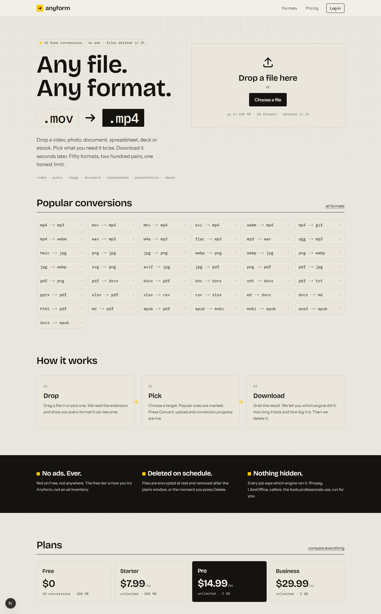
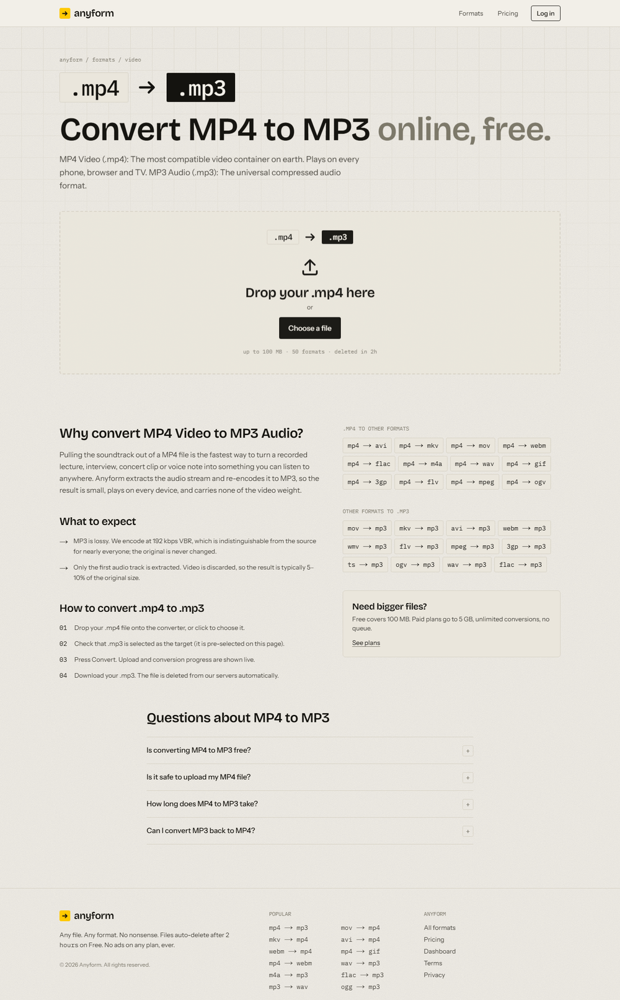
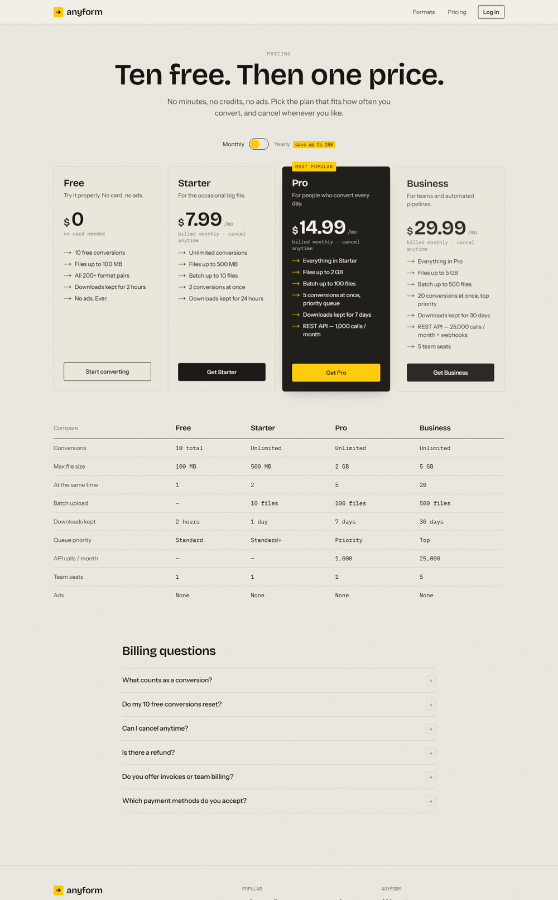

# Anyform

**Any file. Any format. No nonsense.**

Anyform is a web app that converts video, audio, images, documents,
spreadsheets, presentations and ebooks into other formats. Every visitor gets
10 free conversions; subscriptions start at $7.99/month. No ads on any tier.

- Business plan: [`docs/BUSINESS_PLAN.md`](docs/BUSINESS_PLAN.md)
- Architecture & API contract: [`docs/ARCHITECTURE.md`](docs/ARCHITECTURE.md)
- Brand: [`docs/BRAND.md`](docs/BRAND.md) · Roadmap: [`docs/ROADMAP.md`](docs/ROADMAP.md)

## Screenshots

| Home | Pair page (`/convert/mp4-to-mp3`) | Pricing |
| --- | --- | --- |
|  |  |  |

## Stack

| Layer | Tech |
| --- | --- |
| Web | Next.js 15 (App Router), React 19, Tailwind CSS v4, TypeScript |
| API | Fastify 5, Prisma 6, pg-boss (Postgres-backed queue), zod |
| Worker | Same package as the API; engines: ffmpeg, sharp, LibreOffice, pandoc, calibre, poppler, pdf-lib, ImageMagick |
| Data | PostgreSQL 16 · files on local disk or any S3-compatible store |
| Billing | Stripe (behind a provider interface — Paddle-ready) |
| Infra | Docker Compose, single-host friendly |

## Quick start

```bash
cp .env.example .env               # edit secrets
docker compose up -d db            # Postgres on :5432 (or: npm run dev:db — embedded Postgres, no Docker)
npm install
npm run build -w @anyform/shared
npm run db:generate
npm run db:migrate                 # creates tables (prisma migrate dev)

npm run dev:api                    # http://localhost:4000
npm run dev:worker                 # picks up jobs
npm run dev:web                    # http://localhost:3000
```

Or run everything, with all conversion engines baked in:

```bash
docker compose up --build
```

## Repository layout

```
apps/api        Fastify API + worker (src/server.ts, src/worker.ts)
apps/web        Next.js site: landing, /convert/[pair], /formats, /pricing, /dashboard
packages/shared Format registry, plans, quota rules, DTOs, zod schemas
infra           Dockerfiles
docs            Business plan, architecture, brand, roadmap
```

## Scripts

| Command | What it does |
| --- | --- |
| `npm run dev:db` | Embedded PostgreSQL on :5433 (no Docker), data in `data/pg`, server log in `data/pg.log` |
| `bash scripts/e2e.sh` | 24-check smoke test against a running stack |
| `npm run build` | Build shared → api → web |
| `npm run typecheck` | Typecheck every workspace |
| `npm test` | Run unit tests (shared + api) |
| `npm run db:migrate` | Create/apply a Prisma migration locally |
| `npm run db:studio` | Browse the database |

## Free tier and plans

The free allowance (`FREE_CONVERSIONS`, default 10) is counted per guest
cookie and carried into the account on sign-up. Paid plans remove the count
limit and raise file size, concurrency, batch size and retention. All plan
numbers live in `packages/shared/src/plans.ts`.

## License

Proprietary. All rights reserved.
